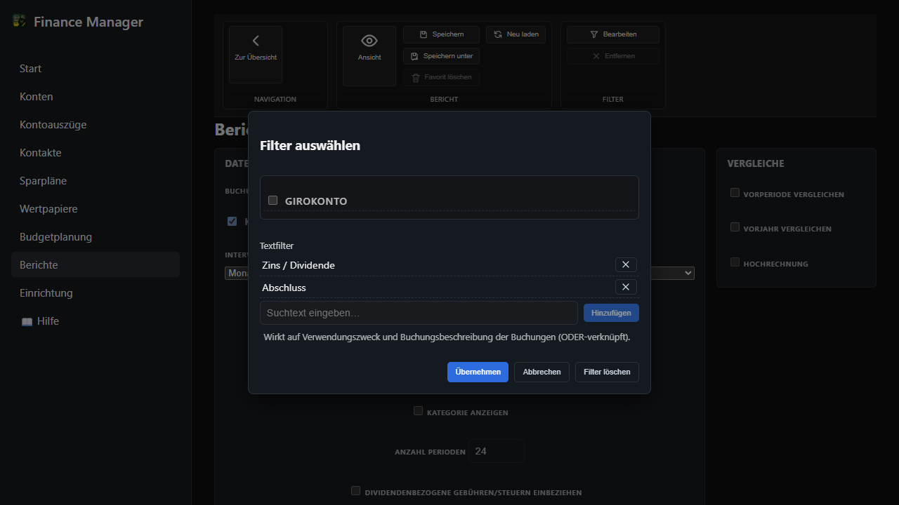

← [Zurück zur Übersicht](index.md)

# Berichtswesen — Ablauf für Anwender

## Voraussetzungen

- Das Berichts-Dashboard ist geöffnet und mindestens eine Buchungsart (Konten, Kontakte, Sparpläne, Wertpapiere) ist ausgewählt.
- Für die Wirkung auf der Startseite wird der Bericht anschließend als Favorit gespeichert und einer KPI-Kachel zugeordnet.

## Schritt-für-Schritt-Anleitung

### 1. Filterdialog öffnen

In der Ribbon-Gruppe **Filter** die Aktion **Bearbeiten** wählen. Der Dialog „Filter auswählen“ öffnet sich.

### 2. Buchungsart wählen

Bei mehreren ausgewählten Buchungsarten erscheinen oben im Dialog Tabs je Buchungsart (**Konten**, **Kontakte**, **Sparpläne**, **Wertpapiere**). Den Tab der Buchungsart wählen, für die Textfilter gelten sollen. Bei nur einer Buchungsart entfällt die Tab-Leiste.

### 3. Textfilter eintragen

Unterhalb der Auswahlliste steht die Gruppe **Textfilter**. Den gewünschten Suchbegriff in das Feld „Suchtext eingeben…“ eintragen und **Hinzufügen** wählen. Der Eintrag erscheint als Liste und lässt sich über die Schaltfläche „Textfilter entfernen“ wieder löschen. Die Schritte können je Tab wiederholt werden — jede Buchungsart besitzt eine eigene Textfilterliste.

> **Hinweis:** Ein Textfilter berücksichtigt eine Buchung, wenn der Begriff im Verwendungszweck oder in der Buchungsbeschreibung vorkommt (Groß-/Kleinschreibung egal). Mehrere Einträge sind ODER-verknüpft — es genügt ein Treffer. Pro Eintrag sind höchstens 500 Zeichen erlaubt; leere Eingaben und Duplikate werden nicht übernommen.

### 4. Filter übernehmen

Mit **Übernehmen** den Dialog schließen — der Bericht wird mit den Textfiltern neu berechnet. **Abbrechen** verwirft die Änderungen am Dialog; **Filter löschen** entfernt alle Filter des Dialogs (inklusive aller Textfilter).

### 5. Optional: Als Favorit speichern

Über die Ribbon-Aktion **Speichern** bzw. **Speichern unter** den Bericht als Favorit ablegen. Die Textfilter werden mit dem Favoriten gespeichert und beim erneuten Öffnen wieder angewendet.

### 6. Optional: KPI-Kachel auf der Startseite

Beruht eine KPI-Kachel der Startseite auf diesem Favoriten, zeigt sie automatisch die gefilterten Werte. Änderungen an den Filtern des Favoriten werden auf der Startseite übernommen — veraltete Kacheldaten werden dabei automatisch verworfen.

## Ergebnis

Der Bericht wertet nur noch Buchungen aus, deren Verwendungszweck oder Buchungsbeschreibung mindestens einen der eingetragenen Suchbegriffe enthält. Die Textfilter wirken zusätzlich zu allen übrigen gewählten Filtern (Entitäten, Kategorien, Buchungsuntertypen).

## Posten zu einem Berichtswert einsehen

### Voraussetzungen

- Das Berichts-Dashboard ist geöffnet; die Ergebnistabelle enthält mindestens eine Zeile mit Beträgen.

### Schritt-für-Schritt-Anleitung

#### 1. Symbolbutton an der Betragszelle wählen

Jede Betragszelle der Spalten **Betrag**, **Vorperiode** und **Vorjahr**, die einen Wert anzeigt, trägt rechts neben dem Betrag eine kleine Schaltfläche mit Lupen-Symbol (Tooltip „Posten anzeigen"). Der Button steht an Entitäts-, Kategorie-, Detail- und Summenzeilen gleichermaßen zur Verfügung.

> **Hinweis:** Zellen ohne Wert („-") sowie die Delta-Spalten und die Spalte **Hochrechnung** besitzen keinen Button.

#### 2. Postenliste im Overlay lesen

Der Button öffnet ein Overlay mit dem Titel „Posten – <Zeilenname> (<Spaltenname>)". Nach einem kurzen Ladehinweis listet die Tabelle je Posten **Datum**, **Herkunft** (Name der zugeordneten Entität, z. B. Konto, Kontakt oder Wertpapier), **Beschreibung** und **Betrag**. Die Fußzeile „Summe" zeigt den Gesamtbetrag — sie entspricht dem Wert der angeklickten Zelle.

Die Liste folgt exakt der Berichtsauswahl: Bei **Vorperiode** und **Vorjahr** stammen die Posten aus der jeweiligen Vergleichsperiode, und alle aktiven Filter (Entitäten, Kategorien, Buchungsuntertypen, Textfilter) wirken identisch auf die aufgelisteten Posten.

> **Hinweis:** Erscheint unterhalb der Tabelle der Hinweis „Die Liste wurde auf die maximal zulässige Anzahl gekürzt.", liegt der Zelle eine größere Postenmenge zugrunde — die Fußzeilensumme bleibt dennoch exakt. Enthält die Zelle keine Posten, zeigt das Overlay die Leeranzeige „Keine Posten gefunden.".

#### 3. Overlay schließen

Das Overlay lässt sich über die Schließen-Schaltfläche (X) oben rechts oder einen Klick auf die abgedunkelte Fläche außerhalb des Dialogs schließen. Es dient ausschließlich der Einsicht — ein Bearbeiten der Posten ist nicht möglich.

### Ergebnis

Die aufgelisteten Posten ergeben exakt den angezeigten Zellwert; für die Einsicht muss der Bericht nicht verlassen werden.

## Barrierefreiheit

- Die Buchungsarten-Tabs im Dialog sind als `role="tab"` mit `aria-selected` ausgezeichnet.
- Die Entfernen-Schaltfläche eines Textfilter-Eintrags trägt die Beschriftung „Textfilter entfernen“ als `title`- und `aria-label`-Attribut.
- Die Hinzufügen-Schaltfläche ist deaktiviert, solange das Eingabefeld leer ist.
- Die Posten-Schaltfläche an den Betragszellen trägt den Tooltip „Posten anzeigen" als `title`-Attribut.
- Das Posten-Overlay ist als `role="dialog"` mit `aria-modal="true"` ausgezeichnet.
