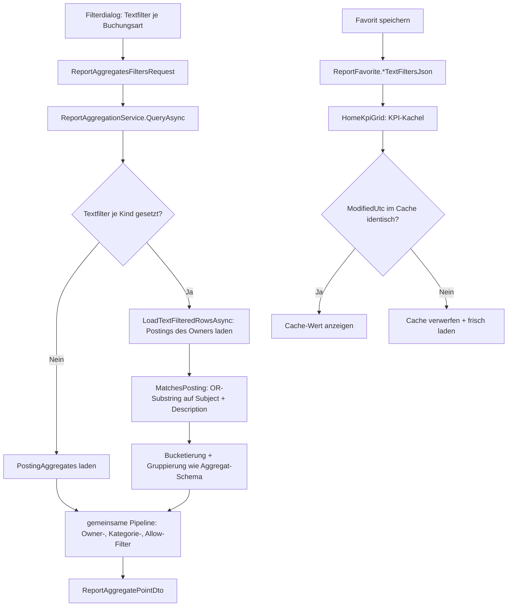

← [Zurück zur Übersicht](index.md)

# Berichtswesen — Technischer Ablauf

## Übersicht

Die Textfilter je Buchungsart wandern als neue Filterdimension durch die bestehende Pipeline: Filterdialog (`ReportDashboardViewModel`) → `ReportAggregatesFiltersRequest` → `ReportsController` → `ReportAggregationFilters` → `ReportAggregationService`. Buchungsarten mit gesetzten Textfiltern werden aus den Rohbuchungen (`Postings`) verdichtet, weil die vorberechneten `PostingAggregates` keine Textfelder führen; alle übrigen Buchungsarten bleiben auf dem Aggregatpfad. Gespeicherte Textfilter liegen als JSON-Spalten am `ReportFavorite` und wirken damit automatisch auf KPI-Kacheln der Startseite sowie auf den MCP-Pfad.

Unabhängig davon liefert die Posteneinsicht zu jeder Betragszelle die zugehörigen Einzelposten über einen eigenen Abfragepfad (Abschnitt 7); die Vergleichsoption `CompareProjection` projiziert wiederkehrende Vorjahresereignisse aller Buchungsarten in den Betrachtungszeitraum (Abschnitt 8).

## Ablauf

### 1. Textfilter im Filterdialog pflegen und anwenden

Im Filterdialog (`FilterDialog_Title` „Filter auswählen“) rendert `ReportDashboard.razor` je aktivem `PostingKind`-Tab unterhalb der Optionsliste die Gruppe `FilterGroup_TextFilters`: Liste der vorhandenen Einträge mit Entfernen-Schaltfläche, Eingabefeld (`maxlength` = `TextFilterList.MaxEntryLength` = 500) und Hinzufügen-Schaltfläche.

Beteiligte Komponenten:

- `ReportDashboardViewModel.TempBankTextFilters`, `TempContactTextFilters`, `TempSavingsPlanTextFilters`, `TempSecurityTextFilters` — Dialog-Arbeitskopien je `PostingKind`
- `ReportDashboardViewModel.NewTextFilterInput` — gebundenes Eingabefeld
- `ReportDashboardViewModel.GetTempTextFilters` / `AddTempTextFilter` / `RemoveTempTextFilter` — Listenverwaltung (Trim, leere/zu lange Einträge werden ignoriert, `OrdinalIgnoreCase`-Dedupe)
- `ReportDashboardViewModel.OpenFilterDialog` — kopiert `Selected*TextFilters` → `Temp*TextFilters` und setzt `ActiveFilterTabKind`
- `ReportDashboardViewModel.ApplyTempAndReloadAsync` — übernimmt `Temp*` → `Selected*` und lädt neu
- `ReportDashboardViewModel.BuildFiltersPayload` — setzt die vier `*TextFilters`-Felder im `ReportAggregatesFiltersRequest`; die `hasText`-Bedingung verhindert `null` als Rückgabe, wenn ausschließlich Textfilter gesetzt sind
- `ReportDashboardViewModel.GetSelectedTempFiltersCount` / `GetSelectedFiltersCount`, `ClearTempFilters`, `ClearFilters` — Zähler für die Disabled-Zustände von `Button_ClearFilters` und der Ribbon-Aktion `FiltersClear`

### 2. Transport über die API

`ReportsController.QueryAsync` mappt die vier Listen des `ReportAggregatesFiltersRequest` 1:1 auf `ReportAggregationFilters` und übergibt sie im `ReportAggregationQuery` an den Service. `CreateFavoriteAsync`/`UpdateFavoriteAsync` mappen dieselben Felder in das `ReportFavoriteFiltersDto`.

Beteiligte Komponenten:

- `ReportAggregatesFiltersRequest` — vier optionale `IReadOnlyCollection<string>?`-Parameter mit `= null`-Defaults
- `ReportAggregationFilters` — identische Feldstruktur für die Aggregationslogik
- `ReportFavoriteFiltersDto` — Persistenz-DTO der Favoriten-Filter
- `ReportsController` — `QueryAsync`, `CreateFavoriteAsync`, `UpdateFavoriteAsync`

### 3. Aggregation mit gesetzten Textfiltern

`ReportAggregationService.QueryAsync` baut zunächst `textFiltersByKind` auf: `TextFilterList.Normalize` trimmt, entfernt leere Einträge und dedupliziert; nur nicht-leere Listen der tatsächlich ausgewählten Kinds landen in der Map. `PostingAggregates` werden nur noch für `kinds ∖ textFiltersByKind` geladen (`aggregateKinds`).

Je textgefilterter Buchungsart lädt `LoadTextFilteredRowsAsync` die Rohbuchungen:

- Owner-Einschränkung auf SQL-Ebene über die kind-eigene Fremdschlüssel-Ids (`Accounts`/`Contacts`/`SavingsPlans`/`Securities` mit `OwnerUserId == query.OwnerUserId`), da `Posting` kein `OwnerUserId` trägt.
- `ApplyDateWindow` begrenzt das Effektivdatum auf `postingWindowEnd` (nur nach oben; `AllHistory`/`Take <= 0` bleiben unbegrenzt).
- Im Speicher: `Amount == 0`-Skip, ODER-Match aller Einträge über `BudgetRulePatternMatcher.MatchesPosting(subject, description, pattern, useRegex: false)` (Substring `OrdinalIgnoreCase` auf dem kombinierten Text `Subject + " " + Description`).
- Bucketierung identisch zum Aggregatpfad: `BookingDate` bzw. `ValutaDate` mit `MinValue`-Fallback (bei `UseValutaDate`), `PeriodStart` über `PostingAggregateService.GetPeriodStart` (`internal`), Gruppierung nach `(PeriodStart, kind-eigene FK, SecuritySubType)` in dasselbe Tupel-Schema wie `rawAnon`.

Anschließend läuft die unveränderte Pipeline: Besitzer-Dictionary-Filterung, Kategorie-Mappings, Top-Level-Allow-Listen, Punktaufbau, Vergleiche.

Beteiligte Komponenten:

- `ReportAggregationService.QueryAsync` — `textFiltersByKind`, `aggregateKinds`, `postingWindowEnd`
- `ReportAggregationService.LoadTextFilteredRowsAsync` — Rohpfad-Verdichtung
- `ReportAggregationService.ApplyDateWindow` — Effektivdatum-Fenster
- `BudgetRulePatternMatcher.MatchesPosting` — Match-Semantik
- `PostingAggregateService.GetPeriodStart` — Perioden-Bucketierung (`internal static`)
- `TextFilterList.Normalize` — Trim/Empty/Dedupe

### 4. Sonderfälle der Aggregation

**Sparplan-Quelle `LinkedAccountPostings`:** Sind `SavingsPlanTextFilters` gesetzt, werden die abgeleiteten Sparplan-Reihen nicht aus Bank-Aggregaten, sondern aus den Bank-**Buchungen** der verknüpften Konten gebildet und gegen `SavingsPlanTextFilters` gematcht (die emittierten Zeilen tragen `Kind = SavingsPlan`, daher gilt der Filter der Ziel-Buchungsart). `BankTextFilters` greifen auf diesem Pfad nicht.

**Netto-Dividendenpfad `QuerySecurityDividendsNetAsync`:** Bei nicht-leeren `SecurityTextFilters` werden die Dividenden-Anker-Buchungen (`SecuritySubType == Dividend`) mit den Textfeldern geladen; die `GroupId`s der Treffer bilden `dividendGroupIds`. Matcht die Anker-Buchung, bleibt die gesamte Gruppe inklusive Fee-/Tax-Netting erhalten — andernfalls entfällt sie komplett.

### 5. Favorit speichern, laden und KPI-Wirkung

`ReportFavorite.SetFilters` erhält vier neue optionale Parameter, serialisiert über `TextFilterList.ToJson` (Normalisierung + `ArgumentException` bei Einträgen > 500 Zeichen) in die Spalten `BankTextFiltersJson`, `ContactTextFiltersJson`, `SavingsPlanTextFiltersJson`, `SecurityTextFiltersJson` (Migration `AddReportFavoriteTextFilters`) und ruft `Touch()` auf (`ModifiedUtc` wird aktualisiert). `GetFilters()` liefert ein 13-elementiges Tupel mit `TextFilterList.FromJson` (tolerant: fehlerhaftes JSON ergibt `null`).

`ReportFavoriteService` projiziert die neuen Spalten in `ListAsync`/`GetAsync`, baut die Entity per `SetFilters` wieder auf und mappt über `ToDtoFilters`/`ApplyFilters`. Der `ReportFavoriteBackupDto` enthält die vier `*TextFiltersJson`-Felder mit `= null`-Defaults — alte Backups bleiben ladbar; `AssignBackupDto` übernimmt sie 1:1.

Auf der Startseite baut `HomeKpiGrid.LoadFavoriteKpiDataAsync` den Aggregations-Request inklusive `fav.Filters.*TextFilters` und speichert `FavKpiData` mit `FavoriteModifiedUtc = fav.ModifiedUtc` (Speicher + LocalStorage-Cache `home.kpi.favorite-{k.Id}`). `RestoreFavoriteCacheAsync` übernimmt einen Cache-Eintrag nur bei übereinstimmender `ModifiedUtc`; bei Abweichung oder fehlendem Favoriten wird der Eintrag per `RemoveAsync` verworfen und der reguläre Miss-Pfad lädt frisch.

Beteiligte Komponenten:

- `ReportFavorite.SetFilters` / `GetFilters` / `ToBackupDto` / `AssignBackupDto`
- `TextFilterList.ToJson` / `FromJson` — JSON-Serialisierung und -Parsing
- `ReportFavoriteService` — Projektionen, `ToDtoFilters`, `ApplyFilters`
- `HomeKpiGrid.LoadFavoriteKpiDataAsync` / `RestoreFavoriteCacheAsync` / `FavKpiData.FavoriteModifiedUtc`
- `IKpiLocalStorageCache` — LocalStorage-Cache `home.kpi.favorite-{k.Id}`

### 6. MCP-Pfad

`FmReportingAggregateHandler.InvokeAsync` unterstützt Textfilter in beiden Pfaden: im Favoriten-Pfad werden `favorite.Filters.*TextFilters` in `ReportAggregationFilters` durchgereicht; im Inline-Pfad akzeptiert `fm_reporting_aggregate` die Argumente `bankTextFilters`, `contactTextFilters`, `savingsPlanTextFilters`, `securityTextFilters` (String-Arrays, `maxLength` 500 je Element). `FmReportsConfigurationManageTool` pflegt dieselben Felder im `filters`-Objekt beim Anlegen/Aktualisieren von Favoriten, und `FmConfigurationReadTool` gibt sie beim Auslesen zurück. Das Parsen übernimmt `McpToolArguments.OptionalStringList` (max. 200 Einträge, max. 500 Zeichen je Eintrag).

### 7. Posteneinsicht — Drill-down auf die Einzelposten einer Betragszelle

Der Symbolbutton an einer Betragszelle ruft die Page-Methode `ShowCellPostingsAsync` (Entitäts-/Kategorie-/Detailzeile) bzw. `ShowTotalPostingsAsync` (Summenzeile, `GroupKey = null`) auf. `ReportDashboardViewModel.ShowPostingsAsync` baut daraus einen `ReportPostingsQueryRequest`, der neben dem Zellkontext (`GroupKey`, `PeriodStart`, `Period` als `ReportPostingsPeriod` = `Current`/`Previous`/`YearAgo`) den vollständigen Aggregationskontext trägt — `PostingKind`/`PostingKinds`, `Interval`, `IncludeCategory`, `CompareProjection`, `UseValutaDate`, `AnalysisDate`, `SavingsPlanPostingSource`, `Take`, `CompareYear` und `BuildFiltersPayload()`.

Der Abruf läuft über `IApiClient.Reports_QueryPostingsAsync` → `POST /api/report-postings` → `ReportsController.QueryPostingsAsync` (setzt `OwnerUserId` aus `ICurrentUserService`, validiert Enums, `GroupKey`, `Take` und die Fenster-Kombination → `400` via `ApiErrorFactory`) → `IReportPostingsQueryService.QueryAsync`.

`ReportPostingsQueryService` liest die rohen `Postings` (nie `PostingAggregates`) und reproduziert die Selektionssemantik der Aggregation, damit die Postensumme dem Zellwert entspricht:

- **Fenster und Schlüssel** stammen aus `ReportQuerySemantics` — den verhaltensneutral aus `ReportAggregationService` extrahierten Helfern (`ComputeCellWindow` je Intervall × Spalte inkl. Ytd-Sonderfenster, `TryParseGroupKey` → `Total`/`Type`/`Category`/`Entity` inkl. `Security:{id}:{subType}`-Suffix, `ApplyDateWindow` mit Valuta-`MinValue`-Fallback).
- **Ownership** wird über die referenzierten Entitäten geprüft (`Posting` trägt kein `OwnerUserId`); `Amount == 0` wird wie in der Aggregation ausgeschlossen.
- **Sonderpfade** identisch zur Aggregation: `LinkedAccountPostings` (verlinkte Sparpläne liefern die Bank-Posten der verknüpften Konten; Sparplan-Textfilter greifen auf diesen Bank-Posten, `Herkunft` = Kontoname) und der Netto-Dividendenpfad (Anker-Posten `SecuritySubType == Dividend` im Zellfenster → `GroupId`s → Gruppenmitglieder `Dividend`/`Fee`/`Tax`; das Ladefenster reproduziert die Aggregationsgrenzen über `Take` und `CompareYear`).
- **Ergebnis:** Sortierung nach effektivem Datum absteigend, datenbankseitiges `Take(MaxPostings = 5000)`, `TotalCount` und `TotalAmount` exakt, `Truncated = TotalCount > MaxPostings`; `EntityName` wird serverseitig als Name der referenzierten Entität aufgelöst.

Das Overlay (`modal-overlay`/`modal postings-modal` auf `ReportDashboard.razor`) kennt die Zustände Laden (`Loading`), Fehler (`Postings_LoadFailed` bzw. der Server-Fehlertext), leer (`Postings_None`) und gekürzt (`Postings_Truncated`); die Fußzeile bindet `PostingsOverlayTotalAmount` — die exakte Serversumme, nicht die Summe der sichtbaren Zeilen.

Beteiligte Komponenten:

- `ReportDashboardViewModel.ShowPostingsAsync` / `HidePostings` + Overlay-State (`PostingsOverlayVisible`/`Loading`/`Failed`/`Error`/`Rows`/`Truncated`/`TotalAmount`/`Title`)
- `ReportsController.QueryPostingsAsync` — `POST /api/report-postings`
- `IReportPostingsQueryService` / `ReportPostingsQueryService` — `MaxPostings = 5000`, `PostingSelection`
- `ReportQuerySemantics` — `ComputeCellWindow`, `TryParseGroupKey`, `ApplyDateWindow` u. a.
- `IApiClient.Reports_QueryPostingsAsync` (`ApiClient.Reports.cs`)

### 8. Artübergreifende Hochrechnung (`CompareProjection`)

Die Vergleichsoption `Hochrechnung` projiziert wiederkehrende Vorjahresereignisse aller ausgewählten Buchungsarten in den Betrachtungszeitraum. Die früher als lokale Funktion in `QuerySecurityDividendsNetAsync` gekapselte Logik liegt in zwei internen Komponenten, die beide Aggregationspfade gemeinsam nutzen:

- `ReportProjectionEventLoader` (`internal`, `AppDbContext` im Konstruktor) lädt die Ereignisse je Buchungsart als `ProjectionEvent(Kind, EntityId, Date, Month, Amount)`: `LoadEntityEventsAsync` für Bank/Kontakt, `LoadSavingsPlanEventsAsync` für Sparpläne (bei `LinkedAccountPostings` über `LoadSavingsPlanAccountLinksAsync` aus den Bank-Buchungen der verknüpften Konten, EntityId = PlanId), `LoadSecurityDividendEventsAsync` für das `GroupId`-Dividenden-Netting (Anker `SecuritySubType == Dividend`, Netto = Dividend + Fee + Tax) und `LoadSecurityHoldingTransactionsAsync` für die Bestandsprüfung. Alle Arten verwenden das Effektivdatum (`UseValutaDate` mit `MinValue`-Fallback) und die jeweiligen `*TextFilters` des Berichts.
- `ReportProjectionCalculator` (`internal static`) enthält die verallgemeinerte Berechnung `ApplyProjectionAmounts` mit `ReportProjectionContext(Interval, Analysis, StartMonth, EndExclusive)`: `DetectPattern` erkennt je Entität das `ProjectionPattern` des Referenzjahres (`Monthly` ab 6 regelmäßige Monatsereignisse, `Quarterly` 2–5 Ereignisse mit 60–125 Tagen Abstand, `Annual` genau ein Ereignis, sonst `Irregular`), `FindExpectedItems`/`FindIrregularExpected` projizieren die Vorjahresereignisse +1 Jahr in das Fenster und `HasCurrentMatch` streicht bereits bestätigte Erwartungen. Die Zuordnung auf die Berichtspunkte erfolgt über `ReportQuerySemantics.TryParseGroupKey` (Entity-Ziel → `Kind`/`EntityId`/`SecuritySubType`), gefolgt von Kategorie- und `Type:`-Rollups ohne Doppelzählung. Ein optionales `hasActiveEntity`-Delegat (`HasPositiveHolding` aus den Holding-Transaktionen) gilt ausschließlich für `Kind == Security`; für die übrigen Arten entfällt die Prüfung, da keine der Entitäten einen Bestands- oder Aktivitätsbegriff besitzt.

Im Standardpfad `QueryAsync` steuern drei Gates die Option: `projectionEnabled` (`CompareProjection && Interval != AllHistory`), `securityProjectionEnabled` (zusätzlich `!hasContradictingSecuritySubTypes` — eine Untertypauswahl ohne `Dividend` unterdrückt nur die Security-Erwartungen) und `comparedProjection` als Rückgabewert `ComparedProjection`. Das Ereignisfenster reicht mit `projectionEventLoadStart = projectionWindowStart.AddYears(-2)` zwei Jahre zurück; der Calculator läuft nach der Latest-Period-Injektion mit `securityDividendLeafOnly: true` (Security-Erwartungen nur auf `…:Dividend`-Zeilen), und die Leer-Latest-Bereinigung behält rein projizierte Zeilen über `hasProjectionData`. Im Netto-Dividendenpfad `QuerySecurityDividendsNetAsync` werden `dividendEvents` und Holding-Transaktionen über denselben Loader bezogen und beide `ApplyProjectionAmounts`-Aufrufe an den Calculator delegiert.

Im Dashboard steht die Checkbox `Label_CompareProjection` bei `CanCompareProjection` (mindestens eine Buchungsart, Intervall nicht `AllHistory`) zur Verfügung. Jede Hochrechnungszelle mit `ProjectionExpectedItems` zeigt eine Info-Schaltfläche (`ProjectionDetails_Open`), die das Overlay mit `Istwerte`/`Erwartete Buchungen`/`Hochrechnung` und den Spalten `Art`/`Herkunft`/`Erwartet am`/`Vorjahresdatum`/`Betrag` öffnet; der MCP-Pfad `fm_reporting_aggregate` liefert dieselben Details als `expectedItems` (`kind`, `entityId`, `untrusted_data.entityName`, `expectedDate`, `priorYearDate`, `amount`).

#### Ausblenden einzelner Erwartungen pro Favorit (`ReportFavoriteId`)

Trägt die Anfrage einen Favoritenkontext (`ReportFavoriteId` auf `ReportAggregatesQueryRequest` → `ReportAggregationQuery`; gesetzt aus dem aktiven Dashboard-Favorit bzw. der Favoritenreferenz einer Home-KPI-Kachel), lädt `ReportAggregationService.LoadSuppressionKeysAsync` die `ReportSuppressedExpectation`-Sätze des Besitzers für genau diesen Favoriten als Schlüsselmenge (`Kind`, `EntityId`, `PriorYearDate.Date`). Ohne `ReportFavoriteId` liefert die Methode `null` — Ad-hoc-Abfragen (inklusive API/MCP) durchlaufen keinen Ausblendungsfilter.

`ReportProjectionCalculator.ApplyProjectionAmounts` erhält die Menge als Parameter `suppressions` und verwirft passende `ProjectionCandidate`s vor `FindExpectedItems` — also vor dem Bestätigungsabgleich. Dadurch sinken `ProjectionAmount` und `ProjectionExpectedItems`, während `Amount`/Istwerte unberührt bleiben. Die Persistenz sichert die Identität (`OwnerUserId`, `ReportFavoriteId`, `Kind`, `EntityId`, `PriorYearDate`) über einen Unique-Index ab; `ReportSuppressedExpectationService` prüft Besitz (Favorit gehört dem Benutzer), ist beim Anlegen idempotent und entfernt Sätze beim Wieder-Einbeziehen. Die Ausblendung koppelt an das Vorjahresdatum: Nach einem Wechsel des Referenzjahres hat die neue Erwartung ein anderes `PriorYearDate` und wird wieder projiziert.

Im Overlay rendern aktive Erwartungen mit aktivem Favorit eine Zeilenaktion `ProjectionDetails_Suppress` („Nicht mehr erwarten"); darunter listet die Sektion `ProjectionDetails_Suppressed_Title` („Ausgeblendete Erwartungen") die unterdrückten Sätze mit `ProjectionDetails_Unsuppress` („Wieder einbeziehen"). Beide Aktionen laden anschließend Aggregation und Ausblendungsliste neu. Löschen des Favoriten entfernt die Sätze per Cascade; im Benutzer-Backup ist `ReportSuppressedExpectations` eine optionale Sektion (Export in `BackupService`, `TryGetProperty`-Import in `SetupImportService` mit Remapping auf die neuen Favoriten-/Entitäts-Ids — Einträge ohne Ziel im Backup werden übersprungen).

Beteiligte Komponenten:

- `ReportProjectionEventLoader` — `LoadEntityEventsAsync`, `LoadSavingsPlanAccountLinksAsync`, `LoadSavingsPlanEventsAsync`, `LoadSecurityDividendEventsAsync`, `LoadSecurityHoldingTransactionsAsync`
- `ReportProjectionCalculator` — `ApplyProjectionAmounts`, `DetectPattern`, `FindExpectedItems`, `FindIrregularExpected`, `HasCurrentMatch`, `GetProjectionPeriodEnd`
- `ProjectionEvent`, `ProjectionCandidate`, `ProjectionPattern`, `ReportProjectionContext` — interne Typen der Hochrechnung
- `ReportQuerySemantics` — `TryParseGroupKey`, `ParseKindFromKey` (Leaf-/Typ-Zuordnung)
- `ReportAggregationService.QueryAsync` / `QuerySecurityDividendsNetAsync` — Gates, Ereignisfenster, `hasProjectionData`
- `ReportAggregatePointDto.ProjectionAmount`/`ProjectionExpectedItems`, `ReportProjectionExpectedItemDto`
- `ReportDashboard.razor` (`CanCompareProjection`, `OpenProjectionDetails`, `SuppressExpectationAsync`, `UnsuppressExpectationAsync`), `ReportDashboardViewModel.CanCompareProjection`
- `ReportSuppressedExpectation`, `IReportSuppressedExpectationService`/`ReportSuppressedExpectationService`, `ReportsController`-Endpunkte `/api/report-favorites/{id}/suppressed-expectations`
- `ReportAggregationService.LoadSuppressionKeysAsync` — Favoriten-gescopte Schlüsselmenge für `ApplyProjectionAmounts`

### 9. Postenartfilter für Bankbuchungen (`BankPostingTypes`)

Der Bankpostenarten-Filter wandelt die Auswahl `Eingang`/`Ausgang`/`Zinsen`/`Steuern` in eine Allow-List von `BankPostingType`-Enum-Werten um und begleitet sie durch dieselbe Pipeline wie die Textfilter. Die vier Checkboxen der Gruppe `FilterGroup_BankTypes` (nur im `PostingKind.Bank`-Tab sichtbar) arbeiten auf dem Temp-Puffer `TempBankPostingTypes` (`HashSet<int>`); `IsBankPostingTypeSelectedTemp`/`ToggleTempBankPostingType` sind enum-typisiert (`BankPostingType`-Parameter, interne Ablage als `int`). `BuildFiltersPayload` schreibt die Auswahl als `IReadOnlyCollection<int>` in `ReportAggregatesFiltersRequest.BankPostingTypes`; `ReportsController.QueryAsync` mappt sie 1:1 auf `ReportAggregationFilters.BankPostingTypes`. Über MCP akzeptiert `fm_reporting_aggregate` das Argument `bankPostingTypes` (Int-Liste).

**Aggregatpfad:** `ReportAggregationService.QueryAsync` bildet aus `Filters.BankPostingTypes` ein `HashSet<BankPostingType>` (nur wenn `Bank` ausgewählt und die Liste nicht leer). Ist der Filter aktiv, wird `PostingKind.Bank` — wie bei gesetztem Textfilter — aus `aggregateKinds` genommen und über `LoadTextFilteredRowsAsync` aus den Rohpostings verdichtet, da `PostingAggregates` die Postenart nicht führen; der `bankPostingTypes`-Parameter filtert dort in-memory per `Postenart ∈ Allow-List`. Zusätzlich greift `allowedBankTypes` als Top-Level-Allow-List auf den `rawAnon`-Zeilen (`BankPostingType`-Feld des Tupels).

**Projektionspfad:** `LoadEntityEventsAsync` trägt einen optionalen Parameter `HashSet<BankPostingType>? bankPostingTypes` (letzter Parameter, vor `ct`), selektiert `p.PostingType` mit und filtert die Ereignisse in-memory — nur für `kind == PostingKind.Bank`; die übrigen Aufrufstellen (Kontakt, Sparplan) übergeben `null`. Damit enthalten `ProjectionAmount`/`ProjectionExpectedItems` ausschließlich Erwartungen der ausgewählten Postenarten.

**Posteneinsicht:** `ReportPostingsQueryService.LoadPostingsAsync` erhält den Filter als `IReadOnlyCollection<int>?`-Parameter und wendet ihn auf Bank-Postings per `bankTypes.Contains((int)p.PostingType)` an — die Postenliste bleibt damit konsistent zum Zellwert.

**Favoriten und KPI:** `ReportDashboardViewModel.ToFavoriteFilters` (gemeinsame Hilfsmethode von `SaveFavoriteAsync`/`UpdateFavoriteAsync`) überträgt `BankPostingTypes` in das `ReportFavoriteFiltersDto`; `ReportsController` reicht das `Filters`-Objekt der Create-/Update-Requests direkt weiter. Persistiert wird als `ReportFavorite.BankPostingTypesCsv` (Migration `AddReportFavoriteBankPostingTypes`, `SetFilters`/`GetFilters`); `HomeKpiGrid.LoadFavoriteKpiDataAsync` übernimmt `fav.Filters.BankPostingTypes` in den Aggregations-Request der KPI-Kachel.

**Scope-Ausschluss `LinkedAccountPostings`:** Die aus Bankposten verknüpfter Konten abgeleiteten Sparplan-Reihen ignorieren den Filter in allen drei Pfaden — Aggregation, `LoadSavingsPlanEventsAsync` (Projektion) und die Posteneinsicht übergeben bewusst keinen Postenart-Filter für die Quell-Bankposten, damit Zellwert und Drilldown übereinstimmen. `BankPostingType.Unspecified` ist keine Filterauswahl; nicht klassifizierte Bankposten fallen bei aktivem Filter heraus.

Beteiligte Komponenten:

- `ReportDashboardViewModel.TempBankPostingTypes` / `SelectedBankPostingTypes` / `IsBankPostingTypeSelectedTemp` / `ToggleTempBankPostingType` / `ToFavoriteFilters`
- `ReportAggregatesFiltersRequest.BankPostingTypes`, `ReportAggregationFilters.BankPostingTypes`, `ReportFavoriteFiltersDto.BankPostingTypes` — `IReadOnlyCollection<int>?`
- `ReportAggregationService` — `bankPostingTypes`-HashSet, `allowedBankTypes`, `LoadTextFilteredRowsAsync`-Parameter
- `ReportProjectionEventLoader.LoadEntityEventsAsync` — optionaler `bankPostingTypes`-Parameter
- `ReportPostingsQueryService.LoadPostingsAsync` — Drilldown-Filter
- `ReportFavorite.BankPostingTypesCsv` / `SetFilters` / `GetFilters`, `HomeKpiGrid.LoadFavoriteKpiDataAsync`

## Diagramm

## Fehlerbehandlung

- **Eintrag > 500 Zeichen:** `TextFilterList.ToJson` wirft `ArgumentException`; die Favoriten-Endpunkte antworten über `ApiErrorFactory.FromArgumentException` mit `400 BadRequest`. Die UI verhindert die Eingabe bereits über `maxlength` und den deaktivierten Hinzufügen-Button.
- **Leere/Whitespace-Einträge und Duplikate:** werden von `TextFilterList.Normalize` bzw. `AddTempTextFilter` verworfen (kein Fehler).
- **Fehlerhaftes persistiertes JSON** (z. B. manipuliertes Backup): `TextFilterList.FromJson` fängt `JsonException` und liefert `null`, sodass eine beschädigte Spalte die Favoriten-Verarbeitung nicht blockiert.
- **`null`/leere Filterliste:** keine Filterung für diese Buchungsart (Allow-List-Konvention); `Filters = null` beim Favoriten-Update leert auch die Textfilter.
- **MCP-Argumente:** `McpToolArguments.OptionalStringList` lehnt nicht-string Elemente, mehr als 200 Einträge oder überlange Einträge mit `McpToolException` (`Err_Mcp_InvalidArguments`) ab.
- **Ungültige Posten-Anfrage:** unbekanntes `GroupKey`-Format, undefinierte Enum-Werte (`Period`, `Interval`, `PostingKind`, `PostingKinds`, `SavingsPlanPostingSource`), `Take < 0` sowie `Interval == AllHistory` mit `Period != Current` werden sowohl im Controller als auch im Service geprüft und mit `400 BadRequest` beantwortet.
- **Fehler beim Postenabruf:** Das Overlay zeigt bei einem Fehlschlag den lokalisierten Text `Postings_LoadFailed` bzw. den serverseitigen Fehlertext — keine rohen Exception-Meldungen; `OperationCanceledException` wird nicht als Fehler behandelt.
