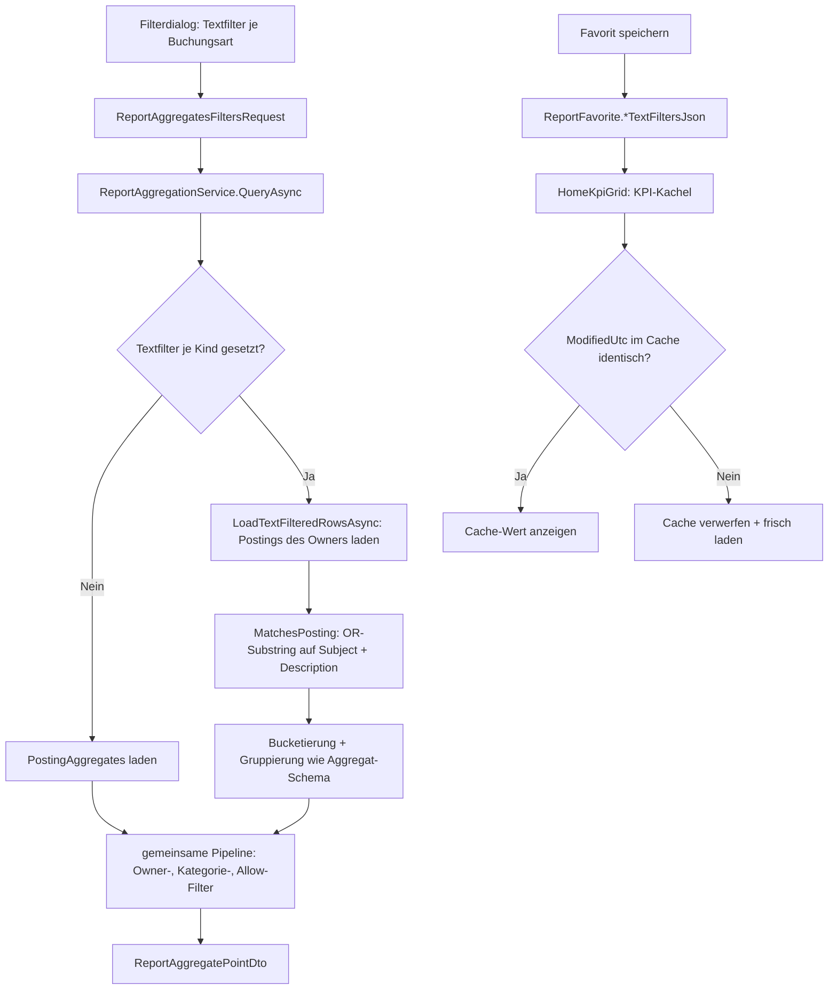

← [Zurück zur Übersicht](index.md)

# Berichtswesen — Technischer Ablauf

## Übersicht

Die Textfilter je Buchungsart wandern als neue Filterdimension durch die bestehende Pipeline: Filterdialog (`ReportDashboardViewModel`) → `ReportAggregatesFiltersRequest` → `ReportsController` → `ReportAggregationFilters` → `ReportAggregationService`. Buchungsarten mit gesetzten Textfiltern werden aus den Rohbuchungen (`Postings`) verdichtet, weil die vorberechneten `PostingAggregates` keine Textfelder führen; alle übrigen Buchungsarten bleiben auf dem Aggregatpfad. Gespeicherte Textfilter liegen als JSON-Spalten am `ReportFavorite` und wirken damit automatisch auf KPI-Kacheln der Startseite sowie auf den MCP-Pfad.

Unabhängig davon liefert die Posteneinsicht zu jeder Betragszelle die zugehörigen Einzelposten über einen eigenen Abfragepfad (Abschnitt 7).

## Ablauf

### 1. Textfilter im Filterdialog pflegen und anwenden

Im Filterdialog (`FilterDialog_Title` „Filter auswählen“) rendert `ReportDashboard.razor` je aktivem `PostingKind`-Tab unterhalb der Optionsliste die Gruppe `FilterGroup_TextFilters`: Liste der vorhandenen Einträge mit Entfernen-Schaltfläche, Eingabefeld (`maxlength` = `TextFilterList.MaxEntryLength` = 500) und Hinzufügen-Schaltfläche.

Beteiligte Komponenten:

- `ReportDashboardViewModel.TempBankTextFilters`, `TempContactTextFilters`, `TempSavingsPlanTextFilters`, `TempSecurityTextFilters` — Dialog-Arbeitskopien je `PostingKind`
- `ReportDashboardViewModel.NewTextFilterInput` — gebundenes Eingabefeld
- `ReportDashboardViewModel.GetTempTextFilters` / `AddTempTextFilter` / `RemoveTempTextFilter` — Listenverwaltung (Trim, leere/zu lange Einträge werden ignoriert, `OrdinalIgnoreCase`-Dedupe)
- `ReportDashboardViewModel.OpenFilterDialog` — kopiert `Selected*TextFilters` → `Temp*TextFilters` und setzt `ActiveFilterTabKind`
- `ReportDashboardViewModel.ApplyTempAndReloadAsync` — übernimmt `Temp*` → `Selected*` und lädt neu
- `ReportDashboardViewModel.BuildFiltersPayload` — setzt die vier `*TextFilters`-Felder im `ReportAggregatesFiltersRequest`; die `hasText`-Bedingung verhindert `null` als Rückgabe, wenn ausschließlich Textfilter gesetzt sind
- `ReportDashboardViewModel.GetSelectedTempFiltersCount` / `GetSelectedFiltersCount`, `ClearTempFilters`, `ClearFilters` — Zähler für die Disabled-Zustände von `Button_ClearFilters` und der Ribbon-Aktion `FiltersClear`

### 2. Transport über die API

`ReportsController.QueryAsync` mappt die vier Listen des `ReportAggregatesFiltersRequest` 1:1 auf `ReportAggregationFilters` und übergibt sie im `ReportAggregationQuery` an den Service. `CreateFavoriteAsync`/`UpdateFavoriteAsync` mappen dieselben Felder in das `ReportFavoriteFiltersDto`.

Beteiligte Komponenten:

- `ReportAggregatesFiltersRequest` — vier optionale `IReadOnlyCollection<string>?`-Parameter mit `= null`-Defaults
- `ReportAggregationFilters` — identische Feldstruktur für die Aggregationslogik
- `ReportFavoriteFiltersDto` — Persistenz-DTO der Favoriten-Filter
- `ReportsController` — `QueryAsync`, `CreateFavoriteAsync`, `UpdateFavoriteAsync`

### 3. Aggregation mit gesetzten Textfiltern

`ReportAggregationService.QueryAsync` baut zunächst `textFiltersByKind` auf: `TextFilterList.Normalize` trimmt, entfernt leere Einträge und dedupliziert; nur nicht-leere Listen der tatsächlich ausgewählten Kinds landen in der Map. `PostingAggregates` werden nur noch für `kinds ∖ textFiltersByKind` geladen (`aggregateKinds`).

Je textgefilterter Buchungsart lädt `LoadTextFilteredRowsAsync` die Rohbuchungen:

- Owner-Einschränkung auf SQL-Ebene über die kind-eigene Fremdschlüssel-Ids (`Accounts`/`Contacts`/`SavingsPlans`/`Securities` mit `OwnerUserId == query.OwnerUserId`), da `Posting` kein `OwnerUserId` trägt.
- `ApplyDateWindow` begrenzt das Effektivdatum auf `postingWindowEnd` (nur nach oben; `AllHistory`/`Take <= 0` bleiben unbegrenzt).
- Im Speicher: `Amount == 0`-Skip, ODER-Match aller Einträge über `BudgetRulePatternMatcher.MatchesPosting(subject, description, pattern, useRegex: false)` (Substring `OrdinalIgnoreCase` auf dem kombinierten Text `Subject + " " + Description`).
- Bucketierung identisch zum Aggregatpfad: `BookingDate` bzw. `ValutaDate` mit `MinValue`-Fallback (bei `UseValutaDate`), `PeriodStart` über `PostingAggregateService.GetPeriodStart` (`internal`), Gruppierung nach `(PeriodStart, kind-eigene FK, SecuritySubType)` in dasselbe Tupel-Schema wie `rawAnon`.

Anschließend läuft die unveränderte Pipeline: Besitzer-Dictionary-Filterung, Kategorie-Mappings, Top-Level-Allow-Listen, Punktaufbau, Vergleiche.

Beteiligte Komponenten:

- `ReportAggregationService.QueryAsync` — `textFiltersByKind`, `aggregateKinds`, `postingWindowEnd`
- `ReportAggregationService.LoadTextFilteredRowsAsync` — Rohpfad-Verdichtung
- `ReportAggregationService.ApplyDateWindow` — Effektivdatum-Fenster
- `BudgetRulePatternMatcher.MatchesPosting` — Match-Semantik
- `PostingAggregateService.GetPeriodStart` — Perioden-Bucketierung (`internal static`)
- `TextFilterList.Normalize` — Trim/Empty/Dedupe

### 4. Sonderfälle der Aggregation

**Sparplan-Quelle `LinkedAccountPostings`:** Sind `SavingsPlanTextFilters` gesetzt, werden die abgeleiteten Sparplan-Reihen nicht aus Bank-Aggregaten, sondern aus den Bank-**Buchungen** der verknüpften Konten gebildet und gegen `SavingsPlanTextFilters` gematcht (die emittierten Zeilen tragen `Kind = SavingsPlan`, daher gilt der Filter der Ziel-Buchungsart). `BankTextFilters` greifen auf diesem Pfad nicht.

**Netto-Dividendenpfad `QuerySecurityDividendsNetAsync`:** Bei nicht-leeren `SecurityTextFilters` werden die Dividenden-Anker-Buchungen (`SecuritySubType == Dividend`) mit den Textfeldern geladen; die `GroupId`s der Treffer bilden `dividendGroupIds`. Matcht die Anker-Buchung, bleibt die gesamte Gruppe inklusive Fee-/Tax-Netting erhalten — andernfalls entfällt sie komplett.

### 5. Favorit speichern, laden und KPI-Wirkung

`ReportFavorite.SetFilters` erhält vier neue optionale Parameter, serialisiert über `TextFilterList.ToJson` (Normalisierung + `ArgumentException` bei Einträgen > 500 Zeichen) in die Spalten `BankTextFiltersJson`, `ContactTextFiltersJson`, `SavingsPlanTextFiltersJson`, `SecurityTextFiltersJson` (Migration `AddReportFavoriteTextFilters`) und ruft `Touch()` auf (`ModifiedUtc` wird aktualisiert). `GetFilters()` liefert ein 13-elementiges Tupel mit `TextFilterList.FromJson` (tolerant: fehlerhaftes JSON ergibt `null`).

`ReportFavoriteService` projiziert die neuen Spalten in `ListAsync`/`GetAsync`, baut die Entity per `SetFilters` wieder auf und mappt über `ToDtoFilters`/`ApplyFilters`. Der `ReportFavoriteBackupDto` enthält die vier `*TextFiltersJson`-Felder mit `= null`-Defaults — alte Backups bleiben ladbar; `AssignBackupDto` übernimmt sie 1:1.

Auf der Startseite baut `HomeKpiGrid.LoadFavoriteKpiDataAsync` den Aggregations-Request inklusive `fav.Filters.*TextFilters` und speichert `FavKpiData` mit `FavoriteModifiedUtc = fav.ModifiedUtc` (Speicher + LocalStorage-Cache `home.kpi.favorite-{k.Id}`). `RestoreFavoriteCacheAsync` übernimmt einen Cache-Eintrag nur bei übereinstimmender `ModifiedUtc`; bei Abweichung oder fehlendem Favoriten wird der Eintrag per `RemoveAsync` verworfen und der reguläre Miss-Pfad lädt frisch.

Beteiligte Komponenten:

- `ReportFavorite.SetFilters` / `GetFilters` / `ToBackupDto` / `AssignBackupDto`
- `TextFilterList.ToJson` / `FromJson` — JSON-Serialisierung und -Parsing
- `ReportFavoriteService` — Projektionen, `ToDtoFilters`, `ApplyFilters`
- `HomeKpiGrid.LoadFavoriteKpiDataAsync` / `RestoreFavoriteCacheAsync` / `FavKpiData.FavoriteModifiedUtc`
- `IKpiLocalStorageCache` — LocalStorage-Cache `home.kpi.favorite-{k.Id}`

### 6. MCP-Pfad

`FmReportingAggregateHandler.InvokeAsync` unterstützt Textfilter in beiden Pfaden: im Favoriten-Pfad werden `favorite.Filters.*TextFilters` in `ReportAggregationFilters` durchgereicht; im Inline-Pfad akzeptiert `fm_reporting_aggregate` die Argumente `bankTextFilters`, `contactTextFilters`, `savingsPlanTextFilters`, `securityTextFilters` (String-Arrays, `maxLength` 500 je Element). `FmReportsConfigurationManageTool` pflegt dieselben Felder im `filters`-Objekt beim Anlegen/Aktualisieren von Favoriten, und `FmConfigurationReadTool` gibt sie beim Auslesen zurück. Das Parsen übernimmt `McpToolArguments.OptionalStringList` (max. 200 Einträge, max. 500 Zeichen je Eintrag).

### 7. Posteneinsicht — Drill-down auf die Einzelposten einer Betragszelle

Der Symbolbutton an einer Betragszelle ruft die Page-Methode `ShowCellPostingsAsync` (Entitäts-/Kategorie-/Detailzeile) bzw. `ShowTotalPostingsAsync` (Summenzeile, `GroupKey = null`) auf. `ReportDashboardViewModel.ShowPostingsAsync` baut daraus einen `ReportPostingsQueryRequest`, der neben dem Zellkontext (`GroupKey`, `PeriodStart`, `Period` als `ReportPostingsPeriod` = `Current`/`Previous`/`YearAgo`) den vollständigen Aggregationskontext trägt — `PostingKind`/`PostingKinds`, `Interval`, `IncludeCategory`, `CompareProjection`, `UseValutaDate`, `AnalysisDate`, `SavingsPlanPostingSource`, `Take`, `CompareYear` und `BuildFiltersPayload()`.

Der Abruf läuft über `IApiClient.Reports_QueryPostingsAsync` → `POST /api/report-postings` → `ReportsController.QueryPostingsAsync` (setzt `OwnerUserId` aus `ICurrentUserService`, validiert Enums, `GroupKey`, `Take` und die Fenster-Kombination → `400` via `ApiErrorFactory`) → `IReportPostingsQueryService.QueryAsync`.

`ReportPostingsQueryService` liest die rohen `Postings` (nie `PostingAggregates`) und reproduziert die Selektionssemantik der Aggregation, damit die Postensumme dem Zellwert entspricht:

- **Fenster und Schlüssel** stammen aus `ReportQuerySemantics` — den verhaltensneutral aus `ReportAggregationService` extrahierten Helfern (`ComputeCellWindow` je Intervall × Spalte inkl. Ytd-Sonderfenster, `TryParseGroupKey` → `Total`/`Type`/`Category`/`Entity` inkl. `Security:{id}:{subType}`-Suffix, `ApplyDateWindow` mit Valuta-`MinValue`-Fallback).
- **Ownership** wird über die referenzierten Entitäten geprüft (`Posting` trägt kein `OwnerUserId`); `Amount == 0` wird wie in der Aggregation ausgeschlossen.
- **Sonderpfade** identisch zur Aggregation: `LinkedAccountPostings` (verlinkte Sparpläne liefern die Bank-Posten der verknüpften Konten; Sparplan-Textfilter greifen auf diesen Bank-Posten, `Herkunft` = Kontoname) und der Netto-Dividendenpfad (Anker-Posten `SecuritySubType == Dividend` im Zellfenster → `GroupId`s → Gruppenmitglieder `Dividend`/`Fee`/`Tax`; das Ladefenster reproduziert die Aggregationsgrenzen über `Take` und `CompareYear`).
- **Ergebnis:** Sortierung nach effektivem Datum absteigend, datenbankseitiges `Take(MaxPostings = 5000)`, `TotalCount` und `TotalAmount` exakt, `Truncated = TotalCount > MaxPostings`; `EntityName` wird serverseitig als Name der referenzierten Entität aufgelöst.

Das Overlay (`modal-overlay`/`modal postings-modal` auf `ReportDashboard.razor`) kennt die Zustände Laden (`Loading`), Fehler (`Postings_LoadFailed` bzw. der Server-Fehlertext), leer (`Postings_None`) und gekürzt (`Postings_Truncated`); die Fußzeile bindet `PostingsOverlayTotalAmount` — die exakte Serversumme, nicht die Summe der sichtbaren Zeilen.

Beteiligte Komponenten:

- `ReportDashboardViewModel.ShowPostingsAsync` / `HidePostings` + Overlay-State (`PostingsOverlayVisible`/`Loading`/`Failed`/`Error`/`Rows`/`Truncated`/`TotalAmount`/`Title`)
- `ReportsController.QueryPostingsAsync` — `POST /api/report-postings`
- `IReportPostingsQueryService` / `ReportPostingsQueryService` — `MaxPostings = 5000`, `PostingSelection`
- `ReportQuerySemantics` — `ComputeCellWindow`, `TryParseGroupKey`, `ApplyDateWindow` u. a.
- `IApiClient.Reports_QueryPostingsAsync` (`ApiClient.Reports.cs`)

## Diagramm

## Fehlerbehandlung

- **Eintrag > 500 Zeichen:** `TextFilterList.ToJson` wirft `ArgumentException`; die Favoriten-Endpunkte antworten über `ApiErrorFactory.FromArgumentException` mit `400 BadRequest`. Die UI verhindert die Eingabe bereits über `maxlength` und den deaktivierten Hinzufügen-Button.
- **Leere/Whitespace-Einträge und Duplikate:** werden von `TextFilterList.Normalize` bzw. `AddTempTextFilter` verworfen (kein Fehler).
- **Fehlerhaftes persistiertes JSON** (z. B. manipuliertes Backup): `TextFilterList.FromJson` fängt `JsonException` und liefert `null`, sodass eine beschädigte Spalte die Favoriten-Verarbeitung nicht blockiert.
- **`null`/leere Filterliste:** keine Filterung für diese Buchungsart (Allow-List-Konvention); `Filters = null` beim Favoriten-Update leert auch die Textfilter.
- **MCP-Argumente:** `McpToolArguments.OptionalStringList` lehnt nicht-string Elemente, mehr als 200 Einträge oder überlange Einträge mit `McpToolException` (`Err_Mcp_InvalidArguments`) ab.
- **Ungültige Posten-Anfrage:** unbekanntes `GroupKey`-Format, undefinierte Enum-Werte (`Period`, `Interval`, `PostingKind`, `PostingKinds`, `SavingsPlanPostingSource`), `Take < 0` sowie `Interval == AllHistory` mit `Period != Current` werden sowohl im Controller als auch im Service geprüft und mit `400 BadRequest` beantwortet.
- **Fehler beim Postenabruf:** Das Overlay zeigt bei einem Fehlschlag den lokalisierten Text `Postings_LoadFailed` bzw. den serverseitigen Fehlertext — keine rohen Exception-Meldungen; `OperationCanceledException` wird nicht als Fehler behandelt.
