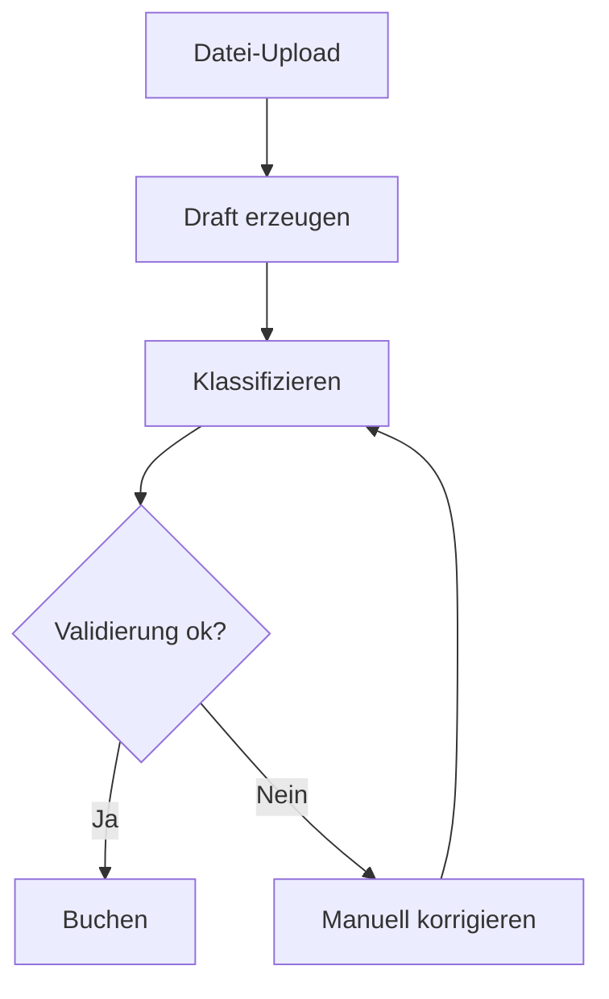

← [Zurück zur Übersicht](index.md)

# Kontoauszüge und Import — Technischer Ablauf

## Übersicht

Der Import besteht aus Upload, Draft-Erstellung, Klassifikation, Validierung und Buchung. Die Orchestrierung erfolgt über `StatementDraftsController` und `StatementDraftService`.

## Ablauf

### 1. Upload und Draft-Erstellung

Datei-Upload wird angenommen und in Entwürfe überführt.

Beteiligte Komponenten:
- `StatementDraftsController.Upload` / `StatementDraftsController.MassImport`
- `StatementDraftService.CreateEmptyDraftAsync`
- `StatementDraftService.AddEntryAsync`

#### Formaterkennung

`IStatementFileFactory` erkennt den Dateityp, anschließend versuchen die registrierten `IStatementFileParser` die Datei positionsbasiert über XML-Templates zu lesen. Für den ING-CSV-Export existieren in `ING_CSV_StatementFileParser._Templates` zwei Templates:

- Altes Layout (9 Spalten): `Buchung;Valuta;Auftraggeber/Empfänger;Buchungstext;Verwendungszweck;Saldo;Währung;Betrag;Währung`
- Neues Layout (10 Spalten, ab ca. September 2026): zusätzliche Spalte `Referenz` zwischen `Verwendungszweck` und `Saldo`; die Spalte wird verworfen (`variable=''`).

Die Templates werden sequenziell versucht; ein Formatfehler (z. B. `FormatException` beim `Betrag`) verwirft das Template und das nächste wird probiert. Gelingt kein Template, gilt die Datei im Massenimport als `Unknown` und erscheint im Review-Dialog mit lokalisierter Meldung `MassImport_Validation_UnknownFileType`.

### 2. Klassifikation und Zuordnung

Entwurfszeilen werden automatisiert oder manuell ergänzt.

Beteiligte Komponenten:
- `StatementDraftService.ClassifyAsync`
- `StatementDraftService.SetEntryContactAsync`
- `StatementDraftService.AssignSavingsPlanAsync`
- `StatementDraftService.SetEntrySecurityAsync`

### 3. Validierung und Buchung

Der Entwurf wird geprüft und in Buchungen geschrieben.

Beteiligte Komponenten:
- `StatementDraftService.ValidateAsync`
- `StatementDraftService.BookAsync`
- `StatementDraftService.CommitAsync`

### 4. Export der Entwurfszeilen

Die Detailseite eines Entwurfs (`/card/statement-drafts/{id}`) bietet im Ribbon die Gruppe `Ribbon_Group_Export` mit den Aktionen `ExportCsv` und `ExportXlsx`. Die Aktionen lösen über `RaiseUiActionRequested` ein UI-Ereignis aus; `CardPage.razor` baut daraus die Download-URL `/api/statement-drafts/{draftId}/export?format=csv|xlsx` und hängt aktive Filter der eingebetteten Eintragsliste (`Search`, `RangeFrom`, `RangeTo`) als Parameter `q`, `from` und `to` an. Der Download wird per JS-Anchor-Klick gestartet; schlägt die JS-Interop fehl, dient `NavigateTo(url, forceLoad: true)` als Fallback.

Der Endpunkt `StatementDraftsController.ExportAsync` prüft das Format (`ExportRequestHelper.TryParseFormat`; leer = CSV), liest das Zeilenlimit aus `Exports:MaxRows` (`ExportRequestHelper.GetMaxRows`, Standard `DefaultMaxRows = 50_000`) und prüft Besitz und Anzeigename über `IStatementDraftService.GetDraftHeaderAsync`. Als Dateiname dient `StatementDraft_{Name}_{yyyyMMddHHmm}.{ext}`, wobei `Name` aus `Description` mit Fallback `OriginalFileName` gebildet und über `ExportRequestHelper.SanitizeFileName` bereinigt wird. CSV wird gestreamt (`StreamCallbackResult` + `IStatementDraftExportService.StreamCsvAsync`), für XLSX wird die Datei vollständig erzeugt (`IStatementDraftExportService.GenerateAsync` via `ExportFileHelper.WriteXlsx`, Arbeitsblatt `Entries`).

`StatementDraftExportService` filtert `StatementDraftEntries` auf die `DraftId`, optional auf einen Datumsbereich (`BookingDate >= From`, `< To + 1 Tag`) und einen Suchbegriff (`EF.Functions.Like` auf `Subject`, `RecipientName`, `BookingDescription`). Die Sortierung erfolgt nach `EntryNumber`, dann `Id`. `ContactId`, `SavingsPlanId` und `SecurityId` werden auf die Entitäten des Eigentümers aufgelöst und als Namen exportiert. Die CSV-Datei verwendet `;` als Trenner und UTF-8 mit BOM; Datumswerte werden als `yyyy-MM-dd`, Beträge mit `InvariantCulture` geschrieben.

Beteiligte Komponenten:
- `StatementDraftCardViewModel.GetRibbonRegisterDefinition` — Ribbon-Gruppe `Ribbon_Group_Export` mit den Aktionen `ExportCsv`/`ExportXlsx`
- `CardPage.razor` (`case "ExportCsv"`/`case "ExportXlsx"`) — URL-Aufbau inkl. Listenfilter und Download-Auslösung
- `StatementDraftsController.ExportAsync` — Endpunkt `GET api/statement-drafts/{draftId}/export`
- `IStatementDraftExportService` / `StatementDraftExportService` — `QueryAsync`, `CountAsync`, `StreamCsvAsync`, `GenerateAsync`
- `ExportRequestHelper` — `TryParseFormat`, `GetMaxRows`, `SanitizeFileName`
- `ExportFileHelper` — `WriteCsvAsync`, `WriteXlsx`, `CsvEscape`, Namensauflösung (`ResolveContactNamesAsync`, `ResolveSavingsPlanNamesAsync`, `ResolveSecurityNamesAsync`)

## Diagramm

## Fehlerbehandlung

- Ungültige Datei- oder Zuordnungsdaten führen zu Validierungsfehlern.
- Nicht autorisierte Draft-Zugriffe werden abgewiesen.
- Laufende Hintergrundjobs (Klassifikation/Bulk-Booking) besitzen Status- und Cancel-Endpunkte.
- Beim Export werden ungültige Formate (`Invalid format`) und eine Überschreitung des Zeilenlimits (`Export limit exceeded`) mit HTTP 400 beantwortet; fehlende oder fremde Entwürfe liefern HTTP 404.
