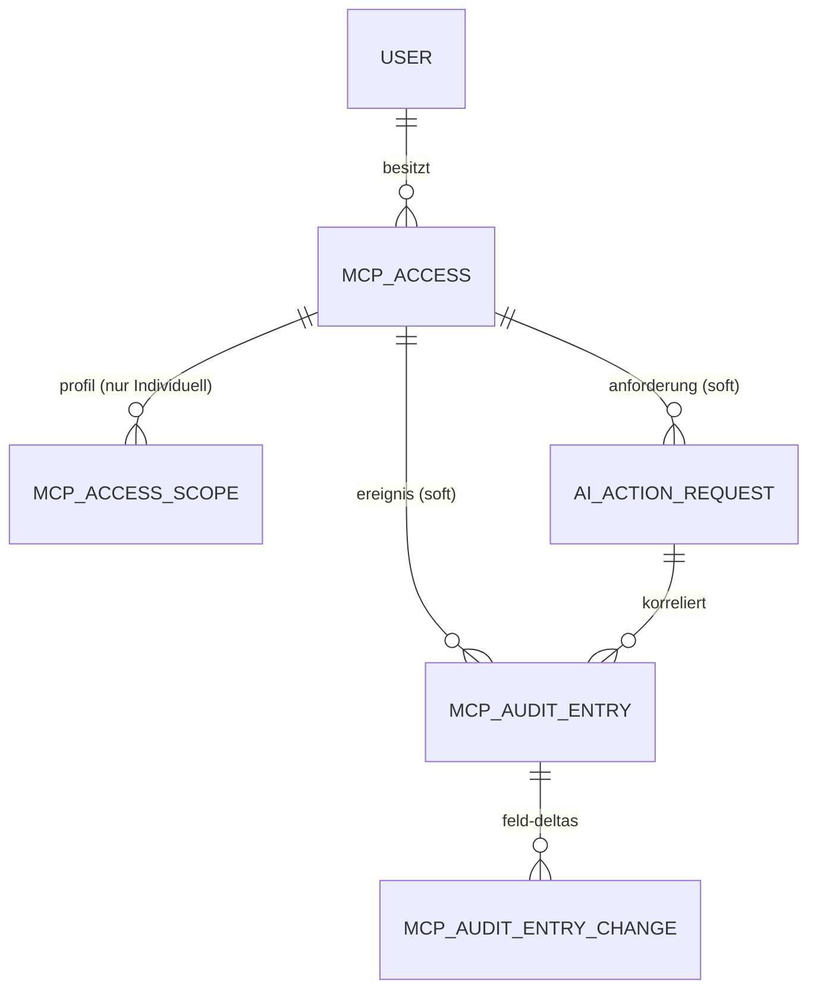

← [Zurück zur Übersicht](index.md)

# MCP-Server — Datenmodell

## Entitäten

### `McpAccess`

| Eigenschaft | Typ | Beschreibung |
|-------------|-----|--------------|
| `Id` | `Guid` | Zugangs-ID |
| `OwnerUserId` | `Guid` | Besitzer; Grundlage aller Sicht- und Rechteprüfungen |
| `Name` | `string` | Anzeigename, eindeutig je Besitzer |
| `Description` | `string?` | Freitext (Zweck/Client; ungeprüfter Inhalt) |
| `AccessKeyHint` | `string` | Nicht geheimer Suchschlüssel des Tokens (`fm_mcp_<hint>_…`), global eindeutig |
| `TokenHash` | `string` | PBKDF2-Hash des Tokens (`pbkdf2|…`); niemals Klartext |
| `Level` | `McpAccessLevel` | Freigabestufe (`Analyse`, `Assistent`, `Sachbearbeiter`, `Buchhalter`, `Individuell`) |
| `ApprovalMode` | `McpApprovalMode` | `PerAction` oder `PreApproved` |
| `Status` | `McpAccessStatus` | `Active`, `Deactivated`, `Revoked`; der Ablauf wird aus `ExpiresUtc` gerechnet |
| `ExpiresUtc` | `DateTime?` | Optionaler Ablaufzeitpunkt; danach verhält sich der Zugang wie deaktiviert |
| `AllowedIpRanges` | `string?` | CSV erlaubter Client-IPs/CIDR-Bereiche |
| `LastUsedUtc` | `DateTime?` | Letzte erfolgreiche Authentifizierung |
| `TokenIssuedUtc` | `DateTime` | Ausstellungszeitpunkt des aktuellen Tokens |
| `RevokedUtc` | `DateTime?` | Widerrufszeitpunkt |
| `RevocationReason` | `string?` | Widerrufsgrund (Benutzerentscheidung oder System) |
| `Scopes` | `ICollection<McpAccessScope>` | Persistierte Scope-Zeilen; nur bei Stufe `Individuell` gefüllt |

### `McpAccessScope`

| Eigenschaft | Typ | Beschreibung |
|-------------|-----|--------------|
| `McpAccessId` | `Guid` | Zugehöriger Zugang (FK, Kaskadenlöschung) |
| `OwnerUserId` | `Guid` | Besitzer (denormalisiert für besitzergestützte Abfragen) |
| `DataType` | `McpDataType` | Einer von 19 Datentypen (`Accounts` bis `Administration`) |
| `Right` | `McpRightKind` | `Read`, `Suggest`, `Complete`, `Modify`, `Create`, `Book`, `Delete` |
| `AccountTypesCsv` | `string?` | Kontotypen-Filter (`AccountType`-Werte `Giro`, `Savings`, `CreditCard`; `CreditCard` = Kreditkarten-Abrechnungskonto, dessen Entwürfe nur indirekt als Split buchbar sind) |
| `ContactCategoryIdsCsv` | `string?` | Kontaktkategorien-Filter |
| `SecurityCategoryIdsCsv` | `string?` | Wertpapierkategorien-Filter |
| `SavingsPlanCategoryIdsCsv` | `string?` | Sparplankategorien-Filter |
| `AttachmentCategoryIdsCsv` | `string?` | Anhangkategorien-Filter |

`null`/leer bedeutet kein Filter; eine gesetzte CSV ist eine positive Wertliste (unklassifizierte Datensätze werden nicht erfasst). Filterdimensionen innerhalb einer Zeile wirken mit UND, Zeilen gleichen Datentyps und gleicher Rechteart mit ODER.

### `AiActionRequest`

| Eigenschaft | Typ | Beschreibung |
|-------------|-----|--------------|
| `OwnerUserId` | `Guid` | Besitzer (= Besitzer des anfragenden Zugangs) |
| `McpAccessId` | `Guid` | Anfragender Zugang (Soft-Referenz, bleibt nach Zugangslöschung lesbar) |
| `McpAccessName` | `string` | Namens-Snapshot des Zugangs |
| `ToolName` | `string` | `fm_*`-Werkzeugname |
| `ActionKey` | `string` | Unteroperation des Aufrufs (z. B. `merge`, `delete`) |
| `CatalogVersion` | `string` | Werkzeugkatalog-Version (`katalog-v<n>`) zum Anfragezeitpunkt |
| `ParameterSnapshot` | `string` | Eingefrorener JSON-Parametersatz (unveränderlich) |
| `ReasonText` | `string?` | Begründung des Clients (ungeprüfter Inhalt) |
| `Status` | `AiActionRequestStatus` | `Pending`, `Approved`, `Rejected`, `Executed`, `Failed`, `Expired` |
| `RequestedUtc` | `DateTime` | Anfragezeitpunkt (Server-Zeit) |
| `ExpiresUtc` | `DateTime` | Entscheidungsfrist; danach läuft die Anforderung ab |
| `DecidedUtc` | `DateTime?` | Entscheidungszeitpunkt |
| `DecidedByUserId` | `Guid?` | Entscheidender Benutzer (Besitzer); `null` bei Systementscheidungen |
| `DecisionNote` | `string?` | Entscheidungsnotiz (Ablehnungsgrund, Vorab-Genehmigung, Systemgrund) |
| `ExecutedUtc` | `DateTime?` | Ausführungszeitpunkt |
| `ExecutionResult` | `string?` | Ergebnisreferenz (angelegte IDs, Zusammenfassung); bei Status `Failed` trägt das Feld stattdessen den klassifizierten Fehler-Wrapper `{"error":{…}}` (`{code, message}` bei definierten Fehlern, `{type}` bei Fremd-Exceptions), den `fm_task_status` als `untrusted_data.error` ausliefert |
| `FailureReason` | `string?` | Klassifizierter `Err_*`-Fehlergrund |
| `CorrelationId` | `Guid` | Korrelation Aufruf ↔ Anforderung ↔ Audit-Einträge |
| `IdempotencyKey` | `string` | Deduplikationsschlüssel, eindeutig je Besitzer |
| `ClaimToken` / `ClaimedUtc` | `Guid?` / `DateTime?` | Aktiver Warteschlangen-Claim des Ausführers |
| `AttemptCount` | `int` | Ausführungsversuche (kein automatisches Retry) |

Zustandsautomat: `Pending → Approved | Rejected | Expired`; `Approved → Executed | Failed | Rejected (nur System) | Expired`. Die Zustände `Executed`, `Failed`, `Rejected` und `Expired` sind terminal; ein direkter Übergang `Pending → Executed` ist technisch ausgeschlossen.

### `McpAuditEntry`

| Eigenschaft | Typ | Beschreibung |
|-------------|-----|--------------|
| `Utc` | `DateTime` | Server-Zeitstempel des Ereignisses |
| `SequenceNo` | `long` | Laufende Nummer innerhalb der Kette |
| `Category` | `McpAuditCategory` | `ToolCall`, `DataChange`, `AccessEvent`, `ApprovalEvent`, `SecurityEvent` |
| `EventType` | `string` | Stabiler Ereigniscode (z. B. `ToolCall`, `TokenRotated`, `RetentionPurged`) |
| `ResultStatus` | `string` | Stabiler Ergebniscode (z. B. `Success`, `Denied`, `RateLimited`) |
| `OwnerUserId` | `Guid?` | Betroffener Besitzer; `null` = globale Kette |
| `McpAccessId` | `Guid?` | Verursachender Zugang (Soft-Referenz) |
| `McpAccessName` | `string?` | Namens-Snapshot des Zugangs |
| `ToolName` | `string?` | `fm_*`-Werkzeug bei Werkzeugaufrufen |
| `CatalogVersion` | `string?` | Katalogversion zum Aufrufzeitpunkt |
| `Context` | `string?` | Kontext (`Ui`, `McpEndpoint`, `System/Job`, `Admin`) |
| `CorrelationId` | `Guid?` | Korrelations-ID |
| `SourceIp` | `string?` | Quell-IP des Client-Aufrufs |
| `DurationMs` | `int?` | Aufrufdauer in Millisekunden |
| `AffectedCount` | `int?` | Anzahl betroffener Datensätze |
| `PayloadJson` | `string?` | Kategoriespezifische Nutzlast (nie Tokenmaterial oder Binärinhalte) |
| `RelatedRequestId` | `Guid?` | Verknüpfte Anforderung (`AiActionRequest`) |
| `PrevHash` | `string?` | Hash des Vorgängereintrags der Kette (`null` beim ersten) |
| `EntryHash` | `string` | Hash über den kanonisierten Eintragsinhalt |
| `Changes` | `ICollection<McpAuditEntryChange>` | Feld-Deltas geänderter Datensätze |

### `McpAuditEntryChange`

| Eigenschaft | Typ | Beschreibung |
|-------------|-----|--------------|
| `EntryId` | `Guid` | Übergeordneter Audit-Eintrag (FK, Kaskadenlöschung) |
| `EntityType` | `string` | Betroffener Entitätstyp (z. B. `Posting`, `Contact`) |
| `EntityId` | `Guid` | Betroffener Datensatz (Drilling-Ziel); immer eine echte Datensatz-ID, nie `Guid.Empty` — für Ereignisse ohne natürliche Entität ein deterministischer `StableId`-Anker (SHA-256 über den fachlichen Schlüssel, z. B. `UpdateSettings`, `UpdateInstallation:<version>`) |
| `Field` | `string` | Name des geänderten Felds |
| `OldValue` | `string?` | Serialisierter Vorher-Wert (längenbegrenzt) |
| `NewValue` | `string?` | Serialisierter Nachher-Wert (längenbegrenzt) |

### `McpSettings`

Genau eine Zeile mit fester ID (`SingletonId`); administratorpflegbar über `/card/mcp-security`. `McpSettings` ist ein globaler, benutzerübergreifender Datenpool — die Schalter gelten installationsweit und tragen bewusst kein `OwnerUserId` (dokumentierte Ausnahme vom Besitzerprinzip).

| Eigenschaft | Typ | Beschreibung |
|-------------|-----|--------------|
| `Enabled` | `bool` | Globaler Schalter; `false` lässt `/mcp` mit `503` antworten (Standard `false`) |
| `WriteAccessEnabled` | `bool` | Schreib-Stopp; `false` lehnt die Klassen `Schreibvorbereitend` und `Genehmigungspflichtig` ab (Standard `false`) |

## Beziehungen

- Ein `McpAccess` gehört zu genau einem `User` (`OwnerUserId`) und besitzt nur bei Stufe `Individuell` persistierte `McpAccessScope`-Zeilen; die übrigen Stufen leiten ihr Profil zur Laufzeit aus der serverseitigen Stufenmatrix ab.
- `AiActionRequest` und `McpAuditEntry` referenzieren den Zugang nur weich (ID plus Namens-Snapshot, bewusst ohne FK-Constraint) — sie bleiben als Protokollsubstrat lesbar, nachdem der Zugang gelöscht wurde.
- Ein `McpAuditEntry` besitzt beliebig viele `McpAuditEntryChange`-Zeilen; `RelatedRequestId` verknüpft ihn mit einer `AiActionRequest`.
- `McpSettings` steht als Singleton ohne Beziehungen.

