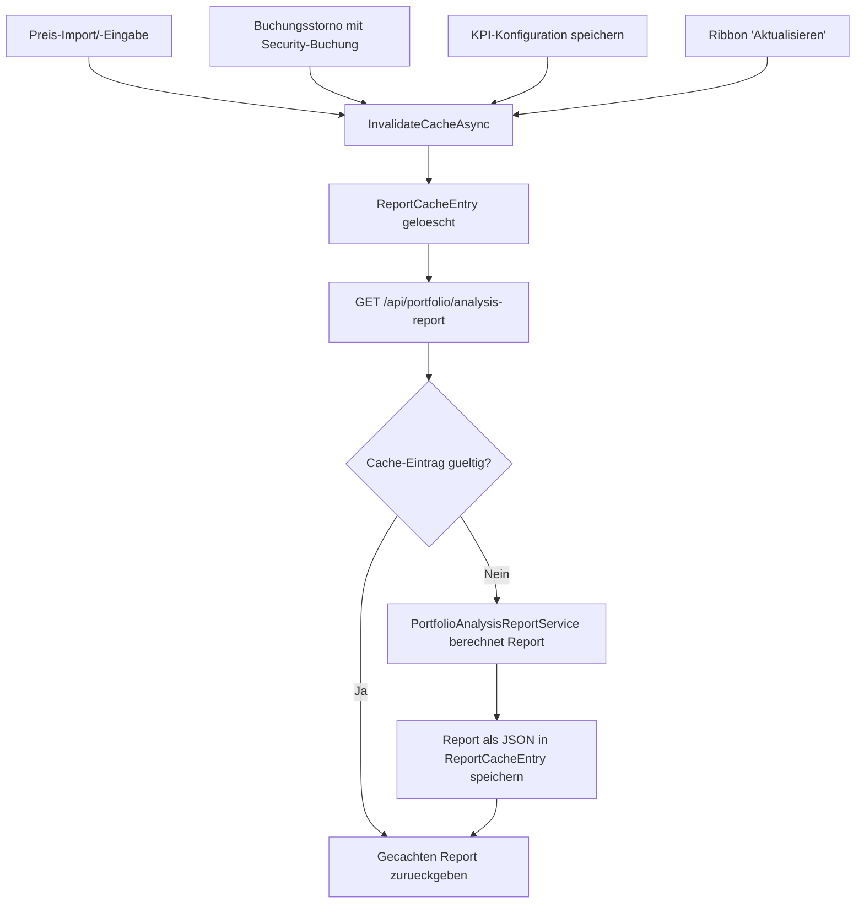

← [Zurück zur Übersicht](index.md)

# Wertpapiermanagement — Technischer Ablauf: Depot-Analysebericht

## Übersicht

Der Depot-Analysebericht aggregiert Kennzahlen über alle Wertpapiere eines
Benutzers hinweg (analog zur Einzelwertpapier-Rendite-Analyse in
`ReturnAnalysisService`, aber depotweit) und cacht das Ergebnis pro Benutzer
bis Monatsende. Beteiligt sind `PortfolioAnalysisReportService` (Berechnung),
`PortfolioAnalysisReportCacheService` (Cache), `IPortfolioKpiConfigurationRepository`
(Kachel-Konfiguration), `PortfolioAnalysisReportController` (API) und
`PortfolioAnalysisReportPageViewModel` / `PortfolioAnalysisReportPage.razor` (UI).

## Ablauf

### 1. Bericht laden (View-Mode)

`PortfolioAnalysisReportPage.razor` erstellt beim Initialisieren ein
`PortfolioAnalysisReportPageViewModel` und ruft `LoadReportAsync()` auf. Diese
Methode ruft zwei Endpunkte parallel-sequenziell ab:

- `GET /api/portfolio/analysis-report` (`PortfolioAnalysisReportController.GetAnalysisReportAsync`)
- `GET /api/portfolio/kpi-configuration` (`PortfolioAnalysisReportController.GetKpiConfigurationAsync`)

Beteiligte Komponenten:
- `PortfolioAnalysisReportPageViewModel.LoadReportAsync` — orchestriert den Ladevorgang, setzt `PortfolioReportData` und `CurrentConfiguration`
- `PortfolioAnalysisReportController.GetAnalysisReportAsync` — liefert den (ggf. gecachten) Bericht für `ICurrentUserService.UserId`
- `PortfolioAnalysisReportController.GetKpiConfigurationAsync` — liefert die gespeicherte Kachel-Konfiguration, oder eine Default-Konfiguration (`Structure`, `Performance`, `Cashflow`, `DepotDevelopment` aktiv, `Risk` inaktiv), wenn noch keine existiert. In beiden Fällen läuft das Ergebnis durch `MergeMissingTiles`: `PortfolioTileId`-Werte, die in der geladenen `TileOrder` fehlen (z. B. nachträglich eingeführte Kacheln), werden ans Ende angehängt und — sofern Mitglied der Default-Aktiv-Menge — zusätzlich in `ActiveTileIds` ergänzt. Das gemergte DTO wird nur zurückgegeben, nicht persistiert.

### 2. Cache-Lookup und Berechnung

`PortfolioAnalysisReportCacheService.GetPortfolioReportAsync` sucht einen
`ReportCacheEntry` mit dem Schlüssel `portfolio-analysis-report-{OwnerUserId:N}`.

- Ist ein Eintrag vorhanden, `NeedsRefresh == false`,
  `CacheValidUntilUtc >= DateTime.UtcNow` und
  `entry.Parameter == CacheSchemaVersion` (aktuell `"6"`), wird der
  gecachte, als JSON gespeicherte `PortfolioAnalysisReportDto`
  deserialisiert und zurückgegeben. Ein abweichender `Parameter`-Wert
  gilt als Cache-Miss — so werden Einträge verworfen, die unter einer
  älteren DTO-Form serialisiert wurden.
- Andernfalls berechnet `PortfolioAnalysisReportService.GetPortfolioAnalysisReportAsync`
  den Bericht neu:
  - `LoadPositionsAsync` lädt alle `Security`-Datensätze des Benutzers samt
    `Region`, `Sector`, `CategoryId`, dazu alle `Posting`-Datensätze mit
    gesetztem `SecuritySubType` und alle `SecurityPrice`-Datensätze; pro
    Wertpapier wird `IFifoCostBasisCalculator.Calculate` aufgerufen.
  - `BuildStructure` summiert Marktwert (`TotalSharesHeld * CurrentPrice`) und
    investiertes Kapital (`TotalCostBasis - StandaloneFeeTotal`) je Position,
    gruppiert nach Kategorie/Region/Sektor (fehlende Werte werden als
    "Ohne Kategorie" bzw. "Unbekannt" gruppiert) und bildet zwei Listen:
    `TopPositions` (Top 10) und `AllPositions` (vollständig, gedeckelt auf
    200 Einträge mit „und N weitere"-Hinweis). Zusätzlich wird pro Wertpapier
    der `InvestedCapitalBreakdown` (FIFO-Lots, ebenfalls gedeckelt auf 200
    Einträge) berechnet.
  - `BuildPerformance` berechnet je Kalenderjahr und je Kalendermonat eine
    Modified-Dietz-Periodenrendite (`ComputePeriodMetrics`) und verkettet die
    Jahreswerte über `IReturnCalculationService.CalculateTwr` zur
    Gesamtrendite seit Beginn.
  - `BuildCashflow` summiert Käufe/Verkäufe/Dividenden des laufenden Jahres
    sowie realisierte Gewinne (Differenz der FIFO-Ergebnisse mit/ohne
    Transaktionen vor Jahresbeginn).
  - `BuildDepotDevelopment` erzeugt je Kalenderjahr vom ersten
    Transaktionsjahr bis zum letzten Serienjahr eine
    `PortfolioDepotDevelopmentYear`-Zeile. Die Seriengrenzen liefert
    `GetSeriesYearRange` (letztes Jahr = laufendes Jahr, solange heute
    Bestände gehalten werden, sonst Jahr der jüngsten Transaktion);
    `GetYearReferenceDate` bestimmt `IsYtd` und den Stichtag (Tagesdatum
    im laufenden Jahr, sonst der 31.12.). `YearEndValue` kommt aus
    `GetPortfolioValueOnDate` zum Stichtag, `NetDividends` als Summe der
    `Dividend`-Buchungen minus Summe der `|Amount|` der `Tax`-Buchungen
    des Jahres, `NetFlow` als Summe der `|Amount|` der `Buy`-Buchungen
    minus Summe der `Sell`-Buchungsbeträge des Jahres und
    `CumulativeInvestedCapital` als je Position auf die
    Transaktionen `<= Stichtag` berechnete FIFO-Basis
    (`TotalCostBasis - StandaloneFeeTotal`). `YearStartValue` ist der
    `YearEndValue` des Vorjahres; im ersten Jahr der Serie dient das
    eigene `CumulativeInvestedCapital` als Startwert.
  - `Risk` wird als `PortfolioRiskDto` mit ausschließlich `null`-Werten
    zurückgegeben (Platzhalter für Phase 2).
  - `CacheValidUntilUtc` wird auf das Monatsende (`EndOfMonthUtc`) gesetzt.
- Das Ergebnis wird als JSON in einem neuen oder bestehenden
  `ReportCacheEntry` gespeichert (`entry.Update` bzw. `new ReportCacheEntry(...)`).

Beteiligte Komponenten:
- `PortfolioAnalysisReportCacheService.GetPortfolioReportAsync`
- `PortfolioAnalysisReportService.GetPortfolioAnalysisReportAsync`, `LoadPositionsAsync`, `BuildStructure`, `BuildPerformance`, `BuildCashflow`, `BuildDepotDevelopment`, `GetSeriesYearRange`, `GetYearReferenceDate`, `GetPortfolioValueOnDate`
- `IFifoCostBasisCalculator.Calculate`, `IReturnCalculationService.CalculateTwr`
- `SecurityValuationHelper.SharesHeldOnDate`, `SecurityValuationHelper.LatestPriceOnOrBefore`

### 3. Kacheln rendern

`PortfolioAnalysisReportPage.razor` iteriert `CurrentConfiguration.TileOrder`,
gefiltert auf `ActiveTileIds`, und rendert je `PortfolioTileId` die passende
Kachel-Komponente: `PortfolioStructureCard`, `PortfolioPerformanceCard`,
`PortfolioCashflowCard`, `PortfolioDepotDevelopmentCard` bzw.
`PortfolioRiskCard`. Jede Kachel bettet ihren Inhalt in die generische
`PortfolioKpiCard` (Titel + Body) ein.

Für die visuelle Darstellung nutzen die Kacheln drei generische
Diagramm-Komponenten aus `FinanceManager.Web/Components/Shared/`:
- `DonutChart` (Ringdiagramm mit Legende und Zentrumswert) — Asset Allocation
  in `PortfolioStructureCard`.
- `MiniBarChart` (kompaktes Balkendiagramm) — jährliche Renditen in
  `PortfolioPerformanceCard` sowie Netto-Einzahlungen/Dividenden/realisierte
  Gewinne in `PortfolioCashflowCard`.
- `PortfolioBarLineChart` (kombiniertes SVG-Linien-/Balkendiagramm mit
  getrennt skalierten Serien — die Linie nutzt die volle Zeichenhöhe, die
  Balken die untere Hälfte —, Legende und `<title>`-Tooltips je
  Datenpunkt) — Jahresserie in `PortfolioDepotDevelopmentCard` im Modus
  „Jahresanfangswert".
- `PortfolioGroupedBarChart` (SVG-Gruppenbalkendiagramm mit zwei Balken
  je Datenpunkt auf gemeinsamer Skala, Basislinie bei 0, Legende und
  `<title>`-Tooltips) — Ein-/Auszahlungen und Netto-Dividenden je Jahr in
  `PortfolioDepotDevelopmentCard` im Modus „Eingezahltes Kapital".

`PortfolioDepotDevelopmentCard` erhält die Jahresserie als Parameter
`Data` (`PortfolioDepotDevelopmentDto`) und hält die beiden
Auswahlwerte als komponenteninternen Zustand (private Enums
`DepotDevelopmentPeriodFilter` und `DepotDevelopmentYieldBasis`). Der
Zeitraum-Filter begrenzt die Anzeige clientseitig auf die letzten 5
bzw. 10 Jahre — verankert am letzten Jahr der Serie, damit auch eine in
der Vergangenheit endende Depot-Historie ihre Abschlussjahre zeigt.

Im Modus „Jahresanfangswert" zeigt die Jahrestabelle Depotwert,
Veränderung (absolut/prozentual), Netto-Dividende, Verhältnis (€/€) und
Rendite (`NetDividends / YearStartValue`; `—` bei Basis 0). Unter
640 px Breite blendet CSS die Spalten „Veränderung %", „Netto-Dividende"
und „Verhältnis" aus und fasst ihre Werte als zweiten Wert in den
Zellen „Dividende/Depotwert" bzw. „Veränderung €/%" zusammen — vier
Spalten ohne horizontales Scrollen.

Im Modus „Eingezahltes Kapital (Yield on Cost)" wechselt die Kachel auf
`PortfolioGroupedBarChart` (Balken `NetFlow` und `NetDividends` je Jahr)
und eine Vier-Spalten-Tabelle: Jahr, Summe der Ein-/Auszahlungen
(kumulierter `NetFlow` über die gesamte Historie bis zur jeweiligen
Zeile, clientseitig berechnet), Netto-Dividende und Rendite
(`NetDividends / kumulierter NetFlow`; `—` bei Basis 0). Der Wechsel der
Rendite-Basis erfolgt ohne Server-Roundtrip; die Fußnote unter der
Tabelle wechselt auf den modusspezifischen Text.

Beide Auswahlwerte werden bei Änderung über `IJSRuntime` in den
`localStorage` des Browsers geschrieben (Schlüssel
`fm.portfolio.dev.yieldBasis` und `fm.portfolio.dev.period`) und in
`OnAfterRenderAsync(firstRender)` wieder eingelesen, sodass die letzte
Auswahl beim nächsten Seitenaufruf wiederhergestellt wird. Der Zugriff
ist try/catch-geschützt und prerender-sicher; der Speicher-Mechanismus
ist unabhängig vom optionalen KPI-Cache und wird im Impressum
(Rechtliches-Seite) dokumentiert.

Kennzahlen mit einer sinnvollen Herleitung (z. B. Gesamtmarktwert, investiertes
Kapital, unrealisierter Gewinn/Verlust, TWR, YTD-Rendite, Netto-Einzahlungen,
Dividenden) binden zusätzlich `KpiInfoButton` ein: Ein Info-Button öffnet ein
Overlay-Panel (`role="dialog"`) mit der Erklärung als Text, Formel oder
Tabelle. Die Erklärungen zum Gesamtmarktwert und zum unrealisierten
Gewinn/Verlust nutzen beide das DTO-Feld `AllPositions` und die gemeinsame
Komponente `PositionsExplanationTable` (Positionsliste mit Marktwert bzw.
Gewinn/Verlust je Position, optional farblich hervorgehoben über
`ColorizePositiveNegative`) in einem scrollbaren Container
(`.kpi-explanation-scroll`), bei Überschreitung von 200 Einträgen mit „und N
weitere"-Hinweis. Die Top-Positionen-Tabelle in der Kachel selbst zeigt nur
noch Name, Marktwert und Anteil — die unrealisierten Gewinne/Verluste sind
ausschließlich in der Erklärung verfügbar. Die Erklärung zum investierten
Kapital nutzt `InvestedCapitalBreakdown` und zeigt je Wertpapier ein
Akkordeon-Element (`<details>/<summary>`) mit den zugehörigen FIFO-Lots,
ebenfalls gedeckelt auf 200 Einträge.

### 4. Konfiguration bearbeiten (Edit-Mode)

1. Klick auf den Ribbon-Button "Bearbeiten" ruft
   `PortfolioAnalysisReportPageViewModel.EnterEditModeAsync()` auf, das die
   aktuelle Konfiguration neu lädt und `IsEditMode = true` setzt.
2. Die Seite kopiert `TileOrder`/`ActiveTileIds` in lokale Bearbeitungslisten
   (`_editOrder`, `_editActive`) und zeigt je Kachel eine Checkbox
   (Sichtbarkeit) sowie Auf-/Ab-Buttons (Reihenfolge über `MoveTile`, das zwei
   benachbarte Listeneinträge vertauscht).
3. Klick auf "Speichern" (`SaveAsync`) baut aus den lokalen Listen ein
   `PortfolioKpiConfigurationRequest` (`ActiveTileIds` = markierte Kacheln in
   `_editOrder`-Reihenfolge, `TileOrder` = vollständige `_editOrder`-Liste) und
   ruft `PortfolioAnalysisReportPageViewModel.SaveConfigurationAsync` auf.
4. `SaveConfigurationAsync` sendet `POST /api/portfolio/kpi-configuration`.
   `PortfolioAnalysisReportController.SaveKpiConfigurationAsync` validiert
   (mindestens eine aktive Kachel; `TileOrder` enthält alle aktiven Kacheln
   ohne Duplikate), persistiert über
   `IPortfolioKpiConfigurationRepository.UpsertAsync` und ruft anschließend
   `IPortfolioAnalysisReportCacheService.InvalidateCacheAsync` auf.
5. Das ViewModel setzt `IsEditMode = false` und lädt den Bericht per
   `GET /api/portfolio/analysis-report` neu — durch die vorangegangene
   Invalidierung wird er dabei frisch berechnet.

Beteiligte Komponenten: `PortfolioAnalysisReportPage.razor`,
`PortfolioAnalysisReportPageViewModel.EnterEditModeAsync` /
`SaveConfigurationAsync` / `CancelEditMode`,
`PortfolioAnalysisReportController.SaveKpiConfigurationAsync`,
`IPortfolioKpiConfigurationRepository.UpsertAsync`,
`IPortfolioAnalysisReportCacheService.InvalidateCacheAsync`

### 5. Cache-Invalidierung durch andere Vorgänge

Zusätzlich zur expliziten Invalidierung beim Speichern der Konfiguration wird
der Cache an zwei Stellen automatisch verworfen:

- `SecurityPriceService.CreateAsync` und `SecurityPriceService.UpsertDailyPricesAsync`
  rufen nach dem Speichern neuer/geänderter Kurse
  `IPortfolioAnalysisReportCacheService.InvalidateCacheAsync` auf (nur wenn
  tatsächlich Einträge eingefügt oder aktualisiert wurden).
- `PostingReversalService.ReversePostingAsync` ruft nach erfolgreichem
  Commit der Stornobuchungen `InvalidateCacheAsync` auf, wenn mindestens eine
  der betroffenen Buchungen `Kind == PostingKind.Security` ist.

Der Ribbon-Button "Aktualisieren" auf der Berichtsseite
(`PortfolioAnalysisReportPageViewModel.RefreshReportAsync`) ruft
`POST /api/portfolio/cache/reset` auf und lädt danach neu — das erzwingt eine
Neuberechnung unabhängig vom Auslöser.

`IPortfolioAnalysisReportCacheService` wird beiden Services als optionale
Abhängigkeit injiziert (`= null` Default), damit bestehende Tests/Aufrufer
ohne Portfolio-Cache-Registrierung weiter funktionieren.

## Diagramm



## Fehlerbehandlung

- Schlägt `LoadReportAsync`, `EnterEditModeAsync`, `SaveConfigurationAsync`
  oder `RefreshReportAsync` fehl, fängt das ViewModel die Exception ab und
  setzt den Fehlerzustand über `SetError(ApiClient.LastErrorCode, ApiClient.LastError)`;
  die Seite bleibt im vorherigen Zustand.
- `SaveKpiConfigurationAsync` liefert `400 Bad Request` (`ValidationProblem`),
  wenn keine Kachel aktiv ist oder `TileOrder` nicht exakt die aktiven Kacheln
  ohne Duplikate enthält.
- Kann der gecachte JSON-Wert nicht deserialisiert werden (`null` nach
  `JsonSerializer.Deserialize`), wird der Bericht wie bei einem Cache-Miss neu
  berechnet.

## Goldenes Kreuz

```mermaid
flowchart TD
    A[GoldenCrossWidget auf /card/securities/{id}] --> B[GET /api/securities/{id}/golden-cross]
    B --> C[GoldenCrossService.GetAsync]
    C --> D[Bis zu LongWindow*3 Schlusskurse laden]
    D --> E[GoldenCrossAnalyzer.Analyze]
    E --> F[GoldenCrossDto: Phase, SMA50/200, Kreuzungsdatum, Einstiegsfenster, Retest, Trend]
    G[ISecurityPriceUpdateService nach Kursabruf] --> H[GoldenCrossService.EvaluateAndNotifyAsync]
    H --> E
    H --> I{Phase > GoldenCrossNotifiedPhase?}
    I -- ja --> J[Notification HomePage, Trigger security:golden-cross:{id}]
    I -- nein --> K[keine Aktion]
```

- Das Widget rendert nur bei `Approaching`/`Crossed`; bei `Far`/`InsufficientData`
  bleibt die Karte ohne Goldenes-Kreuz-Box.
- Fenster und Annäherungsschwelle sind über den Abschnitt `GoldenCross` in
  `appsettings.json` konfigurierbar (`GoldenCrossOptions`):

```json
"GoldenCross": {
  "ShortWindow": 50,
  "LongWindow": 200,
  "ApproachThresholdPercent": 3
}
```

Fachliche Details: [Statistikfeld „Goldenes Kreuz"](goldenes-kreuz.md),
[Business Rules](business-rules.md).
